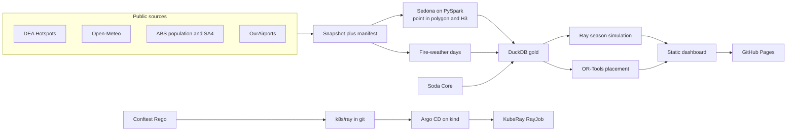

# Bushfire fleet planner

Where should a limited number of large air tankers sit this summer so they can reach the most people and the most fire activity?

Australia is going into a hard fire season. A very strong El Niño is in place through autumn 2027, with very much above-average temperatures across the continent. The spring 2026 outlook already flags heightened risk in northern and south-eastern New South Wales, south-east Queensland, north-east Tasmania, and parts of Western Australia, South Australia, Victoria and the Northern Territory. Extra funding for the National Aerial Firefighting Fleet was announced this month. The practical question is where to pre-position a small number of large aircraft before the demand arrives.

This project answers that with real public data only. It counts recent satellite heat, builds a fire-weather record from daily weather, attaches the population of each region, and compares two ways of parking six large aircraft: the placement that covers people and fire activity together, and a biggest-cities line-up.

**This is a planning picture, not a dispatch order.** Satellite heat is not a confirmed bushfire. See [Limitations](#limitations).

[](https://github.com/LuciferDataEngineer/bushfire-fleet-planner/actions/workflows/ci.yml)
[](https://github.com/LuciferDataEngineer/bushfire-fleet-planner/actions/workflows/pages.yml)
[](LICENSE)

Live dashboard: [https://luciferdataengineer.github.io/bushfire-fleet-planner/](https://luciferdataengineer.github.io/bushfire-fleet-planner/)

Figures below are from the snapshot taken **14 November 2026, 9:33 am AEDT**.

## Headline result

Park six large aircraft at **Tamworth, Mildura, Kalgoorlie, Longreach, Kununurra and Alice Springs**. Within 90 minutes of getting the call (15 minutes to get airborne, then 450 km/h) that set reaches:

| | Recommended bases | Biggest cities (Sydney, Melbourne, Brisbane, Perth, Adelaide, Newcastle) |
| --- | ---: | ---: |
| People | **93.0%** | 93.5% |
| This week's satellite heat | **96.6%** | 9.5% |
| Dangerous-weather days, 2022–2025 | **87.3%** | 32.7% |

The cities already cover the people. They miss the heat, which this week is in inland Queensland, the Northern Territory and northern Western Australia. The inland bases still reach the capitals inside 90 minutes, so the people coverage barely changes.

That 90-minute window is doing a lot of the work. At 60 minutes the same inland bases reach only **34.0%** of people, while the city airports still reach **90.0%**. A shorter flight time would pull aircraft back toward the capitals and off this week's fires.

Other numbers worth keeping:

- **6.6 million** people live in the quarter of regions with the most dangerous fire weather. **80.3%** of this week's satellite heat is in those same regions.
- Residents of the Northern Territory see about **22** dangerous fire-weather days a year. People in New South Wales and Victoria see about **1**.
- Queensland has the largest share of this week's heat: **5,302 of 10,795** clearer detections, almost all of them in Queensland - Outback, Townsville, Mackay and Central Queensland.
- Where people live, a hotter-day replay of the real record produces about **5** severe fire-weather days in a 120-day season, against about **1** in an ordinary draw.
- The week-ahead outlook in this snapshot peaks at a danger score of **53** (severe) in Western Australia on **17 November**. One state reaches the severe band.

Detail and method notes are in [INSIGHTS.md](INSIGHTS.md). The dashboard states the same findings without the method names.

## Architecture



CI rebuilds the gold tables and the site from the committed snapshot. It does not call the live APIs. A separate workflow can refresh the snapshot.

## Tech stack

| Piece | Why it is here |
| --- | --- |
| Apache Sedona on PySpark, local mode | Distributed point-in-polygon of satellite detections onto regions, then H3 cells so the same fire is counted once per day. Also runs in CI. |
| DuckDB with the spatial extension | Gold tables and the serving layer. The same point-in-polygon test is timed in DuckDB so the two engines can be compared. No Postgres and no hosted database. |
| Ray | Parallel, seeded Monte Carlo of fire-season days. Each region is one task. The draw only replays days that actually happened. |
| KubeRay on kind, installed with Helm | The same sampler, on a small real extract, runs as a RayJob in CI. |
| Google OR-Tools CP-SAT | Chooses 6 bases to maximise a weighted mix of people, dangerous-weather days and this week's heat. A one-worker search keeps the result stable. |
| Argo CD on kind | Syncs `k8s/ray` from this git repo at the commit under test. |
| OPA Conftest | Rego checks on every manifest in `k8s/`: cpu and memory limits, no `:latest` tags, `runAsNonRoot: true`. |
| Soda Core | Row, null, range and duplicate checks on the DuckDB gold tables. |
| pytest and ruff | Unit tests for the fire-weather formula, distances, the optimiser, the seeded sampler, and the dashboard wording. A contract test checks the built pages. |
| Dockerfile and Compose | One command reproduces the pipeline on the snapshot. |
| GitHub Pages | Static dashboard. No tile server. The map is an SVG drawn at build time. |

## What's new vs the previous project

Project 14, living-cost-squeeze, was a lakeFS write-audit-publish flow on MinIO, SQLMesh on DuckDB, Argo Workflows on kind, and OpenTelemetry with Jaeger, plus conformal forecasts. Earlier projects in the series used dbt, Dagster, Kafka, Debezium, Spark streaming, Delta, Iceberg, Trino, ClickHouse, Flink, Airflow, Feast, MLflow, Evidently, PyMC, OpenLineage, Great Expectations, Pandera, Terraform and Helm.

This project moves to a geospatial and decision problem, and adds five things that project 14 did not have:

- Sedona for distributed geospatial joins, not just tabular SQL.
- Ray for a seeded season simulation, plus a real KubeRay RayJob rather than only a local process.
- OR-Tools for a maximal covering location problem, with a biggest-cities baseline and the coverage difference reported in people, heat and dangerous weather.
- Argo CD GitOps, syncing the Ray job from the repo, in place of Argo Workflows.
- OPA Conftest policy-as-code on the manifests, and Soda Core checks on the gold tables.

## Data sources

All of these are free, openly licensed, and were fetched with no API key. Nothing in the snapshot was invented.

| Publisher | What | URL | Licence | Coverage in this snapshot | Accessed |
| --- | --- | --- | --- | --- | --- |
| Geoscience Australia | Digital Earth Australia Hotspots, recent GeoJSON feed | https://hotspots.dea.ga.gov.au/data/recent-hotspots.json | CC BY 4.0 | Detections from 10 Nov 2026 21:57 UTC to 13 Nov 2026 21:37 UTC. Kept when confidence is at least 80 and the point is inside longitude 112–154, latitude −44.5 to −10. 115,393 of 177,798 feed features. | 14 Nov 2026, 9:33 am AEDT |
| Open-Meteo | Archive daily weather at each region's official point | https://archive-api.open-meteo.com/v1/archive | CC BY 4.0 | Daily max temperature, min relative humidity, max wind, precipitation, local timezone, 1 Jan 2021–13 Nov 2026. 188,584 rows. | same |
| Open-Meteo | Week-ahead daily forecast | https://api.open-meteo.com/v1/forecast | CC BY 4.0 | 14–20 Nov 2026, same variables. 616 rows. This is the forecast that was current when the snapshot was taken. | same |
| Australian Bureau of Statistics | Estimated resident population by SA4 | [Regional population, 2024–25, Table 3](https://www.abs.gov.au/statistics/people/population/regional-population/2024-25/32180DS0003_2001-25.xlsx) | CC BY 4.0 | ERP at 30 June 2025. The 2025 figures are preliminary. 27.6 million people across the 88 regions in the study. | same |
| Australian Bureau of Statistics | ASGS Edition 3 SA4 boundaries and representative points | [SA4 MapServer](https://geo.abs.gov.au/arcgis/rest/services/ASGS2021/SA4/MapServer) | CC BY 4.0 | Generalised polygons (`maxAllowableOffset` 0.02 degrees) and the official representative point used as the place an aircraft has to reach. | same |
| OurAirports | Airports and runways | https://ourairports.com/data/ | Public domain | 63 candidate bases. See the rule below. | same |

Hashes, byte sizes and row counts are in [`data/snapshot/manifest.json`](data/snapshot/manifest.json).

### What was checked and did not work

The DEA product description points at a historic hotspot archive (`https://hotspots.dea.ga.gov.au/files/historic`, including `all-data-csv.zip`) and at a WFS. On 13 November 2026:

- WFS GetCapabilities listed only recent layers (`public:hotspots`, `public:hotspots_three_days`, and satellite-pass layers). There is no multi-year layer.
- WFS GetFeature requests returned no bytes before timing out.
- The advertised zip URLs returned the website HTML shell, about 12 KB, not an archive.
- A public listing of the `ga-sentinel` bucket contains raw satellite granules, not the hotspot table.

Historical fire activity in this project is therefore the fire-weather record. Satellite heat is the recent feed only. NASA FIRMS was not used: it needs a key.

### Candidate bases

From the OurAirports extract, a base is a candidate when all of these hold:

- the airport is in Australia
- the type is large or medium
- the longest paved runway is at least 1,800 m
- it has scheduled service, or it is a large airport, or the name contains "RAAF", or the ident is YPTN (Tindal) or YSNW (Nowra)

That yields 63 airports, listed in [`data/snapshot/airports.csv`](data/snapshot/airports.csv). Richmond is included because the name contains RAAF. Tindal and Nowra are included by ident because their public names omit "RAAF".

### Aircraft assumptions

These are choices, not measurements.

| Choice | Value |
| --- | --- |
| Aircraft | 6 large air tankers |
| Cruise speed | 450 km/h |
| Time to get airborne | 15 minutes |
| Covered | The region's ABS representative point is inside 90 minutes, including the 15 minutes. That is about 560 km. |
| Also reported | The same bases scored at 60 minutes |
| Planning mix | 50% population, 30% dangerous-weather days, 20% this week's heat |
| Biggest-cities line-up | The main airport, by runway length, in each of the six city areas with the most people living within 100 km. A second airport within 150 km is not used. |

The biggest-cities six are Melbourne, Sydney, Brisbane, Perth, Adelaide and Newcastle.

## Cleaning and transformation

1. Keep hotspot features with confidence of at least 80 inside the continental window. Drop duplicate ids.
2. Convert each detection time to an Australian Eastern calendar day. November 2026 is on Australian Eastern Daylight Time (UTC+11). One national clock is used so a day means the same thing in every table. Western Australia is two or three hours behind that clock near midnight.
3. Sedona joins each point to an SA4 polygon (`ST_Intersects`) and tags it with an H3 cell at resolution 7 (about 5 km²). If a point touches two polygons, the lower region code is kept.
4. One event is one region, one H3 cell, one Eastern day. Satellites that saw the same cell that day are collapsed. The raw feed had 115,393 clearer detections; 114,931 fell inside a study region; they collapse to 10,795 events.
5. Daily weather is turned into a fire-weather score. The first year (2021) spins up the drought index and is not used in the climatology. Dangerous days are 2022–2025 only, divided by four to get a yearly rate.
6. Regions with no polygon, migratory and "no usual address" codes, and Other Territories are left out of the basing choice and the map. That leaves 88 regions.
7. DuckDB holds the gold tables. Soda checks them. The site is rendered from those results.

## Data model

Bronze, in `data/snapshot/`:

- `hotspots.parquet` — filtered detections
- `weather_daily.parquet`, `weather_forecast.parquet`
- `sa4_boundaries.geojson`, `sa4_points.geojson`
- `population_sa4.csv`, `airports.csv`

Silver:

- hotspot events after the spatial join and the daily H3 collapse
- fire-weather days, with the drought index, drought factor and danger score

Gold, in `outputs/fleet.duckdb` (rebuilt by the pipeline, not committed):

| Table | Grain |
| --- | --- |
| `gold_region_risk` | One row per region: population, dangerous days per year, heat events, planning weight |
| `gold_hotspot_event` | One row per region, day and H3 cell |
| `gold_fire_weather_day` | One row per region and day with a danger score |
| `gold_placement` | Six recommended bases and six city bases |
| `gold_coverage_summary` | People, heat and dangerous-weather coverage at 60 and 90 minutes |
| `gold_simulation` | Severe days per 120-day season, ordinary draw and hotter-day draw |

## How to run

Python 3.12 and a Java 17 or 21 runtime. Spark uses Java.

```bash
python3 -m venv .venv
.venv/bin/pip install -r requirements.txt
make test
make pipeline
make soda
```

`make pipeline` reads only `data/snapshot/`. It rewrites `site/` and `k8s/ray/fixture.csv`.

Refresh the snapshot from the public sources (this does use the network, and it is not part of CI):

```bash
make snapshot
```

Docker, same pipeline:

```bash
docker compose build
docker compose run --rm pipeline
```

The dashboard is static files in `site/`. From that directory, `python3 -m http.server` is enough to click through it. On GitHub Pages the site is served from the repository root of the Pages deployment, and the links are relative.

## Testing and CI

[`.github/workflows/ci.yml`](.github/workflows/ci.yml) runs on pull requests and on main:

1. ruff
2. pytest, excluding the contract tests
3. the pipeline on the snapshot
4. contract tests on the built pages (plain language, KPI counts, chart labels inside the frame, snapshot hashes)
5. Soda Core, 27 checks
6. Conftest on `k8s/`
7. a git diff, so a drift in the site or the Ray fixture fails the job

A second job starts kind, installs the KubeRay operator and Argo CD with Helm, points an Argo CD Application at this commit, and waits until the RayJob logs `RAYJOB_OK`.

Randomness is seeded (`SEED = 15`). OR-Tools uses one search worker. Floats in the site are rounded before they are written. The pipeline does not stamp the run time into the pages, only the snapshot time, so a second run does not churn the HTML.

[`.github/workflows/pages.yml`](.github/workflows/pages.yml) deploys `site/` to GitHub Pages on push to main.

[`.github/workflows/refresh.yml`](.github/workflows/refresh.yml) rebuilds the snapshot on demand and every Monday 16:00 UTC, and uploads it as an artifact. It does not commit. Promoting a new snapshot is a deliberate change to `data/snapshot/` plus a pipeline run.

## Performance

On the snapshot, in this environment (local PySpark, 2 cores, driver memory 2 GB):

| Step | Time | Result |
| --- | ---: | --- |
| Sedona point-in-polygon, 115,393 points × 88 polygons, then H3 aggregation | 4.2 s | 114,931 points inside a region, 10,795 daily cells |
| The same point-in-polygon in DuckDB spatial | 15.3 s | 114,939 points (0.007% gap, on the boundaries) |
| Ray, 88 regions × 200 seasons × 120 days | a few seconds inside the ~35 s end-to-end run | identical output for a fixed seed |

Sedona is the faster of the two spatial engines here, and the counts agree. The KubeRay job does not repeat that scale: a free GitHub-hosted runner cannot comfortably hold kind, Argo CD, the operator, and a full Spark image. The cluster job runs the same sampler on 8 real regions, 12 seasons and 30 days, with one worker beside the head.

## Limitations

- A hotspot is a hot pixel, not a confirmed fire, and not a measure of area burned. Cloud, industry and hot ground can all register.
- The public feed is a few days long. It cannot describe a whole past season. The historic bulk files described by Geoscience Australia were not actually downloadable. See above.
- Fire weather is computed at one official point per region. For a huge outback region that point can sit in desert, so the yearly rate (Western Australia - Outback South is about 90 dangerous days) describes that point, not every town in the region.
- Coverage is "can the aircraft reach that official point in time", not "can it reach every house". At 60 minutes the inland bases miss most of those points even though the airports are in the broad region. At 90 minutes the capitals fall inside the same circles. Do not read 93% as a claim about a shorter response.
- Cruise speed, scramble time, six aircraft, and the 50/30/20 mix are assumptions. Runway length is a filter, not a check that the airport can host a tanker operation.
- The hotter-day scenario does not invent weather and it is not a Bureau forecast. It replays hotter days from 2022–2025 more often.
- One national clock (Australian Eastern time) is used for dates. Near midnight, a detection in Western Australia can fall on a different local date.
- Not operational advice. Do not task aircraft from this page.

## Next steps

- Replace the single representative point with a population grid, so coverage is to where people are inside a large region.
- If Geoscience Australia publishes a usable historic hotspot extract, rebuild the fire-activity side from seasons rather than from one week of heat plus the weather record.
- Test 45, 60 and 90 minute windows as separate placements, not only as a rescoring of the 90-minute bases.
- Ask a fire agency which of the 63 runways can actually take a large air tanker, and drop the rest.
